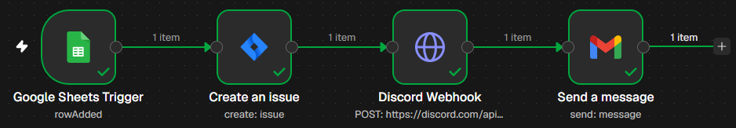
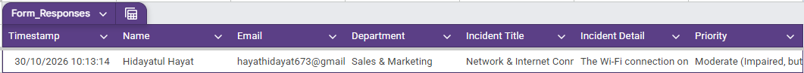
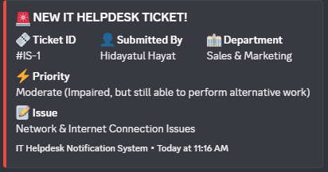

# Automated IT Helpdesk & Ticketing System

An automated internal IT helpdesk ticketing system built with n8n, Google Forms, Jira Cloud, Discord, and Gmail to streamline the reporting and handling of operational issues.

---

## Tech Stack


---

## Background of the Problem

Employees frequently submit technical complaints via private chat channels (such as WhatsApp or internal office messaging) in an uncentralized manner. As a result, the IT team often overlooks these requests, responds slowly, or struggles to track the status of issue resolution.

---

## Workflow Pipeline

1. **User Submission:** Users submit operational issue reports through Google Forms.
2. **Detection (n8n):** The `Google Sheets Trigger` node detects new spreadsheet entries every minute using polling.
3. **Ticket Creation (Jira):** Automatically creates an issue in Jira Software (type: `Bug`/`Incident`) containing the reporter's information, issue details, and priority level.
4. **Internal Notification (Discord):** Sends a real-time embedded notification to the IT team's Discord channel, including the Ticket ID, reporter information, and issue description.
5. **Confirmation Email (Gmail):** Sends an automated ticket acknowledgment email to the reporter, including the Jira Ticket ID (`#KEY`).

---

## Screenshots & Workflow

### Workflow Overview
The complete automation workflow built with n8n, connecting Google Forms, Google Sheets, Jira, Discord, and Gmail.



### Google Sheets Integration
Incoming IT helpdesk submissions are automatically recorded in Google Sheets and monitored by n8n.



### Discord Notifications
The IT team receives automated ticket notifications through Discord, including ticket details, reporter information, and priority levels.



---

## Prerequisites & Tools

- [Docker](https://docs.docker.com/get-docker/) & Docker Compose
- Google Workspace (Google Forms, Google Sheets, and a Gmail sender account)
- Jira Cloud account & Atlassian API Token
- Discord Server (with permission to create webhooks)

---

## Installation Guide (Self-Hosted via Docker)

### 1. Clone the Repository

```bash
git clone https://github.com/Hdytalhayat/n8n-it-helpdesk.git
cd n8n-it-helpdesk
```

### 2. Configure Environment Variables

Copy the environment template:

```bash
cp .env.example .env
```

Adjust the configuration parameters as needed, especially when deploying to a public VPS.

### 3. Start Docker Containers

```bash
docker compose up -d
```

Access the n8n interface at:

`http://localhost:5678`

---

## ⚙️ n8n Workflow Setup

1. Open the n8n dashboard and create an owner account if this is your first time running n8n.
2. Navigate to **Workflows** → Click the three-dot menu (`...`) in the top-right corner → Select **Import from File**.
3. Select the workflow file: `workflows/it-helpdesk-ticketing.json`.
4. Configure credentials for each node:

   - **Google Sheets Trigger:** Connect your Google Workspace account using OAuth2.
   - **Create an Issue (Jira):** Provide your Atlassian credentials (Atlassian email and API Token).
   - **Discord Webhook:** Replace the URL parameter in the HTTP Request node with your own Discord Webhook URL.
   - **Send a Message (Gmail):** Connect the IT Helpdesk account using Gmail OAuth2.

5. Change the workflow status from **Inactive** to **Active** to enable automation.

---

## 📋 Google Forms Data Schema

Make sure your Google Form includes the following fields to ensure compatibility with the workflow template:

| Field | Type / Description |
|---|---|
| Name | Short text |
| Email | Short text (with email format validation) |
| Department | Dropdown |
| Priority | Multiple choice: `Low`, `Medium`, `High`, `Critical` |
| Incident Title | Short text |
| Incident Detail | Paragraph |

---
